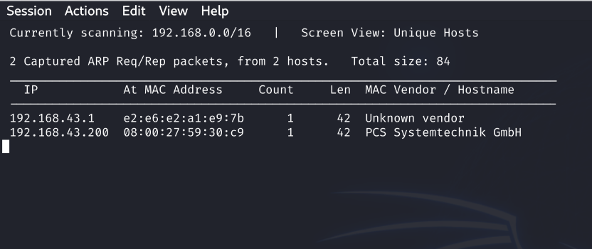
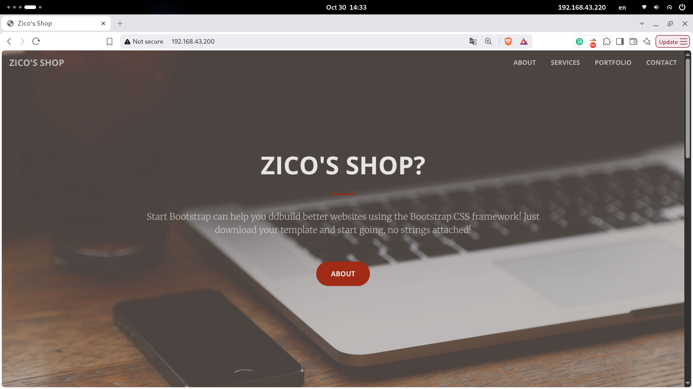
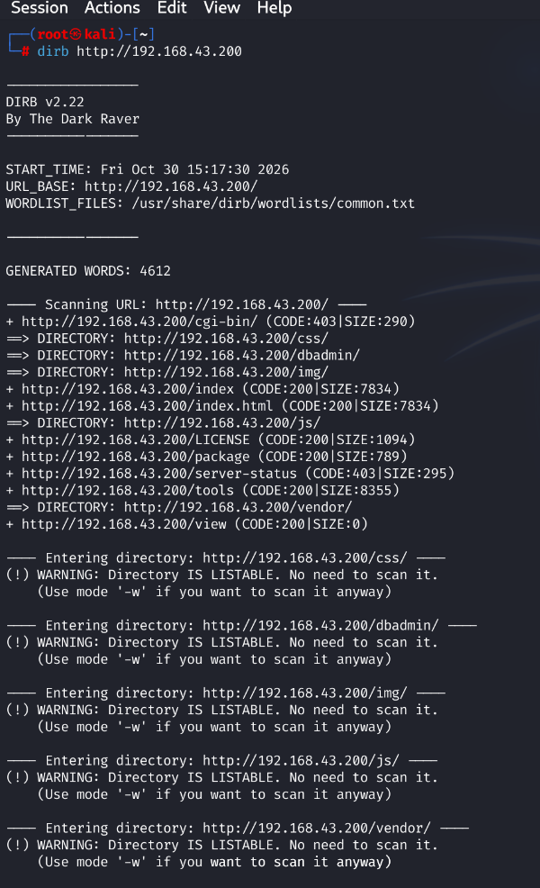

<div align="center">

# Zico2

### CTF Write-up

[English](README.md) | [فارسی](README.fa.md)

</div>

---


## 1. Network Discovery

The first step was to identify the target machine on the local network.

I used `netdiscover` to scan the local network and discover active hosts. The scan output was used to identify the target machine's IP address:

- **Target IP:** `192.168.43.200`

The command-line output is shown below.



This information provides the target IP for the next enumeration steps.

## 2. Web Enumeration

After identifying the target machine, I entered its IP address (`192.168.43.200`) in the web browser.

A simple online store page appeared, confirming that a web application was running on the target machine.




## 3. Directory Enumeration

Next, I used **DIRB** to discover directories and files exposed by the web server:

```bash
dirb http://192.168.43.200
```

The scan identified several paths, including `/css/`, `/dbadmin/`, `/img/`, `/js/`, and `/vendor/`. It also found `/index`, `/index.html`, `/LICENSE`, `/package`, `/server-status`, `/tools`, and `/view`.

One result that stood out was **`/dbadmin/`**. DIRB reported that this directory was listable, meaning its contents could be browsed through the web server. This made it a useful path to investigate further.

Other notable responses included HTTP 403 for `/cgi-bin/` and `/server-status`, while `/index`, `/index.html`, `/LICENSE`, `/package`, and `/tools` returned HTTP 200.



